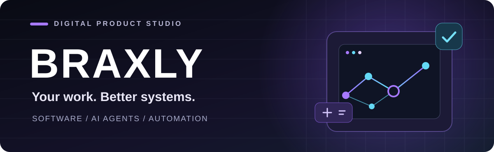
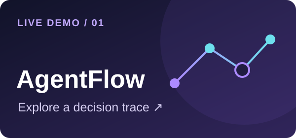

  

<h2 align="center">Your work deserves better systems.</h2>

  We build custom software, AI agents, bots, and digital products around the way people actually work.
  From one stubborn workflow to an entire platform, we make the complex feel clear.

  <a href="mailto:contactbraxly@gmail.com"><strong>Start a project</strong></a>
  &nbsp;&nbsp;·&nbsp;&nbsp;
  <a href="https://github.com/braxlyco?tab=repositories">See our work</a>

 

### FEATURED / KNOWLEDGE AGENT

Ask a question, inspect the source passages, and see an answer that does not guess beyond the documents. **[Try the browser demo](https://braxlyco.github.io/knowledge-agent/)** · **[Explore the code](https://github.com/braxlyco/knowledge-agent)**. The live demo uses retrieval; the repo also includes a local Ollama integration for model-generated answers.

 

### WHAT WE BUILD

<table>
  <tr>
    <td width="50%" valign="top"><strong>01 &nbsp; Custom software</strong> Business systems, internal tools, dashboards, and applications designed for a specific job.</td>
    <td width="50%" valign="top"><strong>02 &nbsp; AI agents & bots</strong> Assistants and automations that help teams handle information and repetitive work.</td>
  </tr>
  <tr>
    <td valign="top"><strong>03 &nbsp; Portals & platforms</strong> Customer, staff, vendor, and operations portals with the workflows behind them.</td>
    <td valign="top"><strong>04 &nbsp; Integrations & automation</strong> APIs, connected data, notifications, and smoother handoffs between systems.</td>
  </tr>
  <tr>
    <td valign="top"><strong>05 &nbsp; Mobile & field tools</strong> Practical apps for on-site work, scanning, and data capture.</td>
    <td valign="top"><strong>06 &nbsp; Built for your workflow</strong> Something unusual? We shape the solution around the problem instead of a template.</td>
  </tr>
</table>

 

### TRY THE AUTOMATIONS

Two interactive previews of human-reviewed automation. They run in your browser with transparent rules and no connected AI model.

<table>
  <tr>
    <td width="50%" valign="top">
       
      <strong>AgentFlow Studio</strong> 
      Change a lead, support, or invoice case and inspect its decision trace. 
      <a href="https://braxlyco.github.io/agentflow-studio/">Open live demo</a> · <a href="https://github.com/braxlyco/agentflow-studio">View code</a>
    </td>
    <td width="50%" valign="top">
       
      <strong>InboxPilot</strong> 
      Triage a message, edit its draft reply, and record human review. 
      <a href="https://braxlyco.github.io/inboxpilot/">Open live demo</a> · <a href="https://github.com/braxlyco/inboxpilot">View code</a>
    </td>
  </tr>
</table>

 

### SELECTED WORK

<table>
  <tr>
    <td width="33%" valign="top">
       
      <strong><a href="https://github.com/braxlyco/BrewNest-Coffee-Management">BrewNest</a></strong> 
      Coffee shop operations across sales, kitchen, inventory, procurement, and payments.
    </td>
    <td width="33%" valign="top">
       
      <strong><a href="https://github.com/braxlyco/DBM">Workshop DMS</a></strong> 
      A workshop operations prototype from job card to invoice.
    </td>
    <td width="33%" valign="top">
       
      <strong><a href="https://github.com/braxlyco/RFID-Scanner-Java">RFID Scanner</a></strong> 
      Offline UHF tag scanning for rugged Android handhelds.
    </td>
  </tr>
</table>

Our public work spans .NET, Blazor, Django, Java, Android, SQL, and connected APIs.

 

  

